# Variational vs. Wasserstein Autoencoders — from flat pixels to 3D voxels

> Two ways to regularize a latent space (**KL** vs. **MMD**), pushed across four datasets and two dimensionalities — with the trade-off measured, not just asserted, and a close look at *where each one breaks*.

<p align="center">
  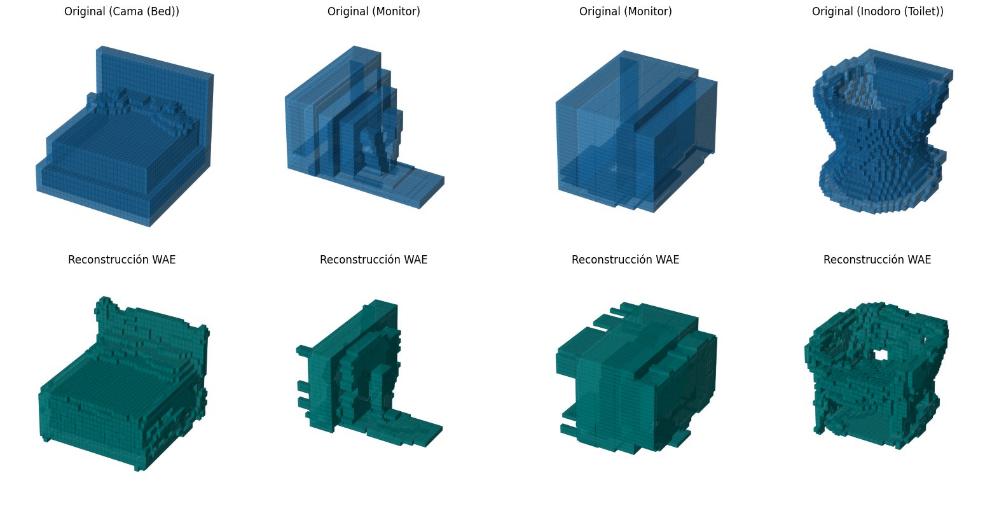
</p>
<p align="center"><i>WAE-MMD reconstructing unseen 32³ furniture voxels (ModelNet10 subset): bed, monitor, monitor, toilet. Top row original, bottom row reconstruction.</i></p>

---

## TL;DR 

We implemented and compared two latent-variable generative models — a classic **Variational Autoencoder (VAE)** trained with the **KL divergence**, and a **Wasserstein Autoencoder (WAE)** trained with **Maximum Mean Discrepancy (MMD)** — across **four datasets** spanning two very different domains:

- **2D images:** MNIST, FashionMNIST, CIFAR-10 (PyTorch)
- **3D volumes:** 3D-MNIST and a 4-class subset of **ModelNet10** (`bed`, `chair`, `monitor`, `toilet`) as raw `32×32×32` voxel grids (TensorFlow)

**The one thing to take away:** KL regularizes *every sample individually*, which forces a smooth, well-clustered latent space but makes the decoder **average and blur** its outputs. MMD only matches the *aggregate* latent distribution, so it spends more of its gradient budget on reconstruction — sharper 2D images, more solid 3D contours, but a slightly looser latent geometry. **This trade-off held consistently across all four datasets**, and it's most visually obvious in 3D, where the VAE leaves "voxel fog" and the WAE sculpts connected chair legs and backrests.

We didn't just claim this — we **swept the MMD weight λ over five orders of magnitude** to find where the trade-off balances, and we **broke the latent space on purpose** (removing regularization) to watch it fail. See [What broke / what we learned](#what-broke--what-we-learned).

---

## Why this project is more than "a VAE on MNIST"

A VAE on MNIST is a tutorial. Three things make this a real study:

1. **KL vs. MMD, same backbone.** The encoder/decoder are identical between variants; *only* the latent regularizer changes (KL → MMD with an IMQ kernel). So every difference in the outputs is attributable to the loss, not the architecture. This reproduces the core claim of the WAE paper (Tolstikhin et al., ICLR 2018) and tests whether it survives contact with our own data.
2. **2D → 3D volumetric.** Going from `Conv2D` on flat images to `Conv3D` on `32³` voxel tensors is where the interesting engineering pain lives: a parameter explosion, aggressive overfitting, and reconstructions you have to render as thresholded 3D voxel plots to even judge.
3. **We measured the knobs.** Rather than picking hyperparameters by feel, we ran explicit sweeps on the MMD weight (λ) and the latent dimension, and reported the tables.

---

## Results at a glance

### The KL-vs-MMD trade-off, in numbers (MNIST)

Both models reach nearly the same reconstruction quality, but look at *how* they spend the loss. The VAE pays a permanent, large "tax" (KL ≈ 124 at epoch 20) to keep each posterior Gaussian. The WAE's distributional penalty is nearly negligible (MMD ≈ 10), so almost all of its gradient goes to reconstruction:

| Epoch | VAE-KL Loss | VAE-KL Recon | KL | WAE-MMD Loss | WAE-MMD Recon | MMD |
|------:|------------:|-------------:|-----:|-------------:|--------------:|-----:|
| 1  | 5911.2 | 5886.1 | 208.8 | 9292.0 | 9080.4 | 211.6 |
| 10 | 1258.9 | 1129.9 | 128.9 | 1172.8 | 1160.8 | 12.0 |
| 20 | 1078.6 |  954.9 | 123.8 |  992.9 |  982.7 | 10.1 |

<p align="center">
  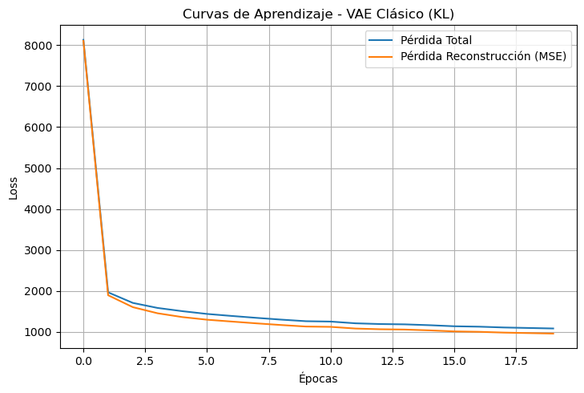
</p>
<p align="center"><i>VAE-KL learning curve. The persistent gap between total loss and reconstruction loss <b>is</b> the KL tax. In the WAE the two curves nearly coincide.</i></p>

### We swept λ to find the balance point

The MMD term is numerically tiny, so its weight λ matters a lot. Too low and the model ignores the prior (becomes a plain autoencoder, poor generation); too high and it over-regularizes and blurs. The sweep on MNIST shows the reconstruction floor climbing as λ grows past 10000 — which is why we picked it:

| λ | Recon @ epoch 20 | MMD @ epoch 20 | Behaviour |
|--:|-----------------:|---------------:|-----------|
| 1000  |  943.1 |  2.9 | Under-regularized (nearly deterministic AE) |
| 5000  |  955.5 |  6.3 | — |
| **10000** | **982.7** | **10.1** | **Chosen: reconstruction still competitive with the VAE, prior well matched** |
| 20000 |  987.1 | 12.8 | Starting to over-regularize |
| 50000 | 1041.0 | 19.9 | Reconstruction clearly degraded |

### The latent space *is* the result

For a generative model the latent geometry matters as much as the pixels. Projecting the encoded test set with t-SNE and overlaying reconstruction thumbnails shows how cleanly classes separate — crisp on MNIST, far softer on CIFAR-10 (which is simply a harder dataset):

<p align="center">
  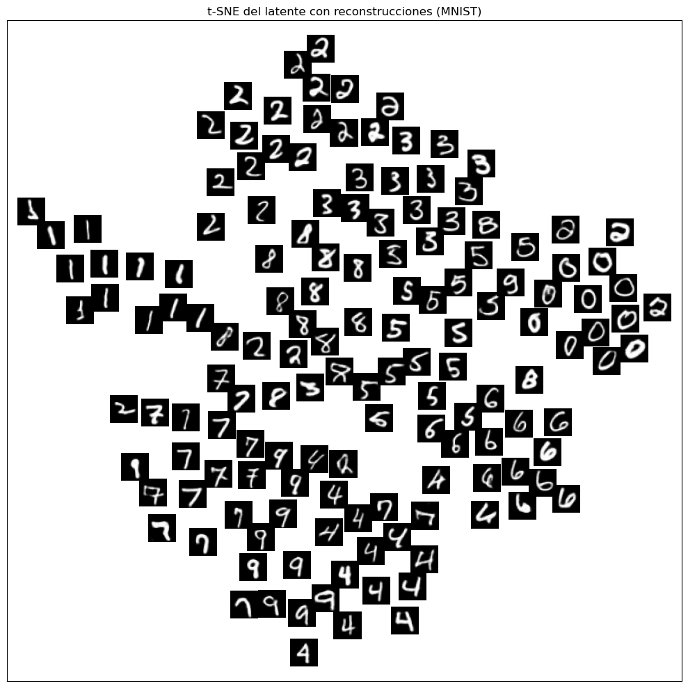
  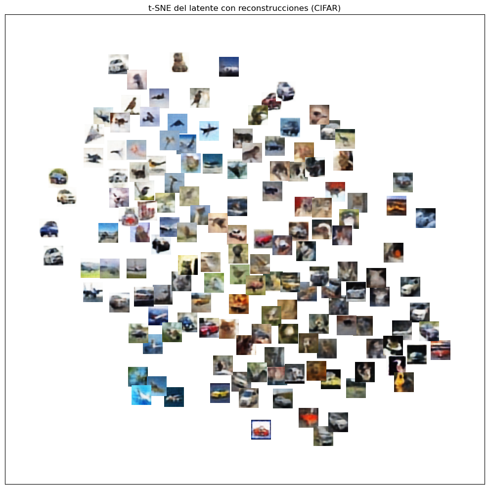
</p>

Sampling straight from the prior `N(0, I)` and decoding gives brand-new digits the model never saw:

<p align="center">
  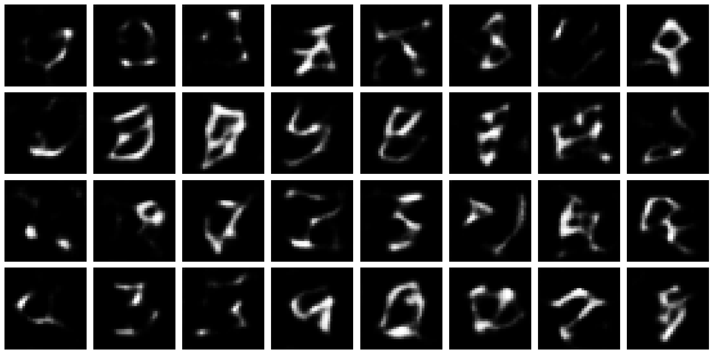
</p>

### Where 2D honestly falls apart: CIFAR-10 and FashionMNIST

Being honest about limits matters more than a highlight reel:

- **FashionMNIST:** compact shapes (sneakers, trousers, bags) reconstruct fine, but the models **smear fine detail** — printed text on t-shirts and check patterns on shirts wash out. The upper-body garments (shirt / pullover / coat / t-shirt) also collapse into one overlapping blob in latent space, because they share too much structure.
- **CIFAR-10:** with a 3-block conv encoder and latent dim 128, reconstructions capture the dominant colour and rough layout (blue sky, red car blob) but **lose all texture** — fur, feathers, edges vanish. t-SNE shows near-total class overlap: the net is clustering by colour/brightness, not semantics. We even swept latent dim (d = 64 / 128 / 256): 64 is too tight, 256 barely helps and is harder to regularize, 128 is the least-bad compromise. The honest conclusion: **this is an architecture-capacity ceiling, not a loss-function problem.**

---

### 3D: this is where KL vs. MMD becomes obvious

On voxel data the difference stops being subtle. **KL (VAE)** leaves probabilistic haze — stray floating voxels in uncertain regions. **MMD (WAE)** produces more solid, connected surfaces.

**3D-MNIST — VAE (KL) reconstruction:**
<p align="center">
  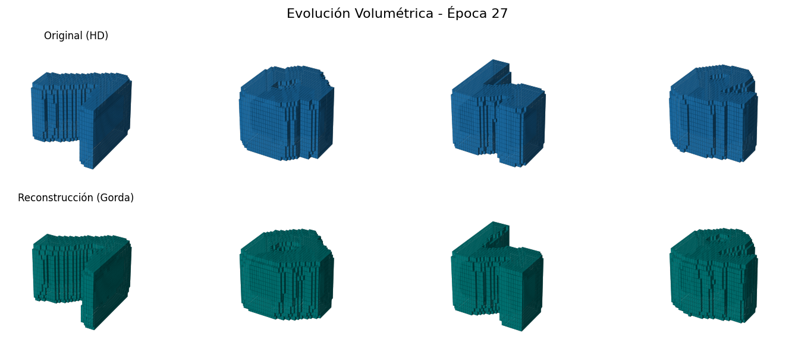
</p>

**3D-MNIST — WAE (MMD) reconstruction:**
<p align="center">
  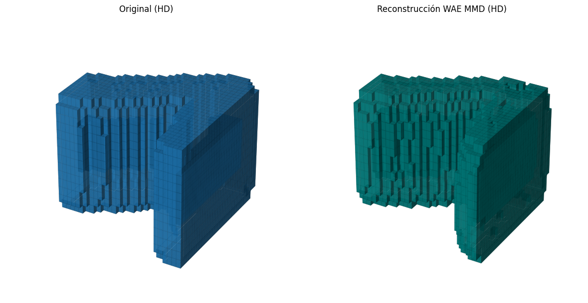
</p>

**Latent interpolation** — walking a straight line in latent space between two digits and decoding each step. Smooth morphing means a well-formed manifold, not just memorized points:

<p align="center">
  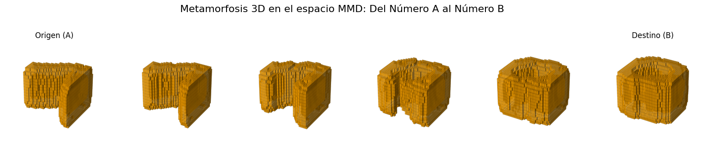
</p>

---

### ModelNet10: real 3D objects, and the overfitting wall

The 4-class furniture subset at `32³` is the hardest test. The parameter count explodes and the model starts memorizing — in the first, unregularized run the VAE lost all generalization from about epoch 30. Fixing that (Dropout 0.3 + Early Stopping, patience 5) is what made the results below possible.

**Reconstruction (original vs. WAE-MMD):**
<p align="center">
  
</p>

**The latent manifold, densely populated.** Slicing the latent plane into a 4×4 grid and decoding each coordinate shows continuous geometric transitions between furniture families — the sign of a healthy latent space (contrast this with the "empty oceans" failure described below):

<p align="center">
  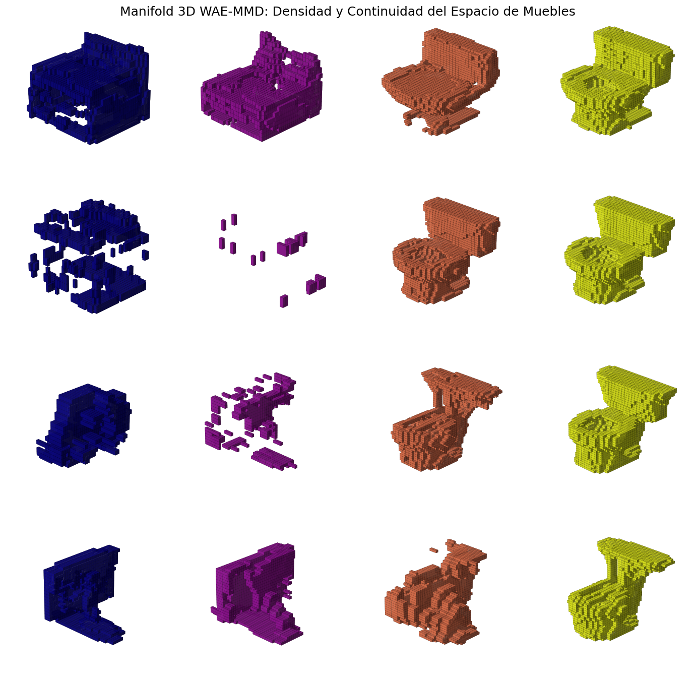
</p>

**Free generation from the prior** and **geometric metamorphosis** (interpolating one object into another):
<p align="center">
  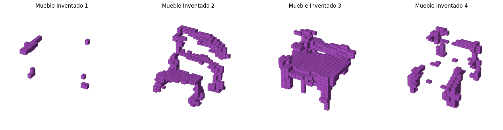
</p>
<p align="center">
  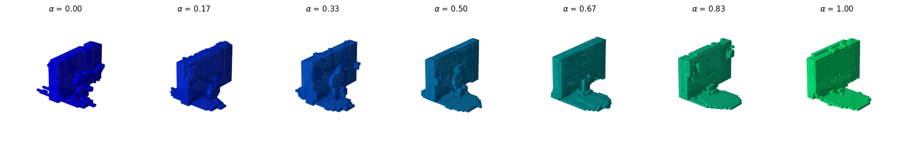
</p>

**Latent structure (PCA, colored by class):**
<p align="center">
  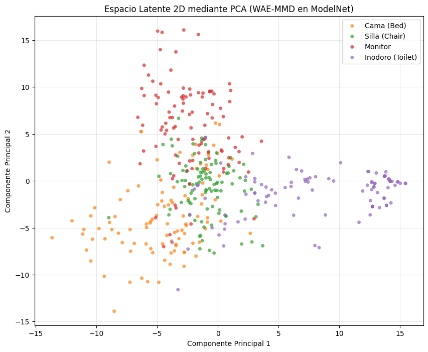
</p>

### ModelNet validation loss: KL vs. MMD, head to head

| Epoch | VAE-KL Total | VAE-KL Recon | VAE-KL KL | WAE-MMD Total | WAE-MMD Recon | WAE-MMD MMD |
|------:|-------------:|-------------:|----------:|--------------:|--------------:|------------:|
| 1     | 7571.66      | 7471.88      | 99.78     | 7136.56       | 6365.94       | 0.08 |
| 10    | 4825.64      | 4621.10      | 204.54    | 5055.09       | 4113.39       | 0.09 |
| Final | 3832.18      | 3574.60      | 257.58    | 4163.31       | 3655.25       | 0.05 |

Read this carefully — it's the whole thesis in numbers. The **VAE-KL reaches a lower *total* loss** (3832 vs. 4163), but that's misleading: its KL term is a huge 257 **and still climbing**, meaning it pays an ever-growing tax to keep the latent space Gaussian. The **WAE-MMD keeps its distributional penalty near zero (0.05)** and devotes almost everything to reconstruction — which is why its objects *look* better despite the higher total. **Lower total loss ≠ better generations.** The flip side, visible in the PCA plots: the VAE's clusters are slightly more spherical and separated, so *its* interpolations are marginally smoother. Each loss wins a different prize.

---

## What broke / what we learned

This is the section we'd actually want a reviewer to read.

- **The latent space collapsed into "empty oceans" before we added Dropout.** In the first unregularized ModelNet run, evaluating the 4×4 manifold grid produced coordinates where *no* voxel crossed the 0.5 presence threshold — literally empty cells (e.g. the point at X≈11.6, Y≈6.9). The latent space was topologically broken: overfit points memorized, everything between them void. Adding Dropout forced the encoder to learn global descriptors instead of memorizing, and the manifold filled in. This is the single clearest "where it breaks" moment in the project, and it's why the dense grid above is a result, not a decoration.
- **KL annealing is not optional for the VAE.** With full KL weight from step 0, the VAE immediately finds the trivial minimum — send all posterior variance to zero, ignore the input, decode the dataset mean (posterior collapse). We ramp β from 0 to 1 over the first 2000 steps so the model first learns to reconstruct, *then* gets regularized. The WAE doesn't need this: MMD is a distributional distance and doesn't suffer the same collapse.
- **A custom `train_step` silently broke a callback — in one notebook.** In the 3D-MNIST notebook the `EarlyStopping` callback monitored `val_loss`, but our custom Keras loop only exposed `val_total_loss` / `val_reconstruction_loss` / `val_kl_loss`. TensorFlow warned every epoch and the callback never fired, so it ran the full 50 epochs. We caught and fixed the metric-name contract for the ModelNet experiments (where early stopping *did* fire and was essential — see the "Final (early-stopped)" row above). Lesson kept in the repo: when you write a custom training step, the metric names you expose are an API, and callbacks fail silently when you break it.
- **Lower total loss is not better images** (the ModelNet table). We stopped trusting a single scalar and learned to weigh reconstruction, latent penalty, and *rendered output* separately.
- **Kernel choice matters for MMD.** We used an **inverse multiquadratic (IMQ)** kernel rather than RBF on purpose: RBF decays exponentially and its gradient vanishes for moderately distant points, which stalls training in high-dimensional latent spaces. IMQ's heavy polynomial tail keeps gradient signal alive between far-apart samples.

---

## Method, briefly

| Component | 2D | 3D |
|---|---|---|
| Framework | PyTorch | TensorFlow / Keras |
| Encoder/Decoder | `Conv2D` stacks | `Conv3D` stacks, `32³` volumes |
| VAE loss | MSE reconstruction + β·KL, with **KL annealing** (2000-step warmup) | BCE reconstruction + β·KL (β=0.01) |
| WAE loss | MSE + λ·**MMD** (λ=10000) | BCE + λ·**MMD**, **IMQ kernel** |
| Regularization | KL annealing | **Dropout 0.3 + Early Stopping** (patience 5) |
| Latent dim | 32 (MNIST/Fashion) / 128 (CIFAR) | 32 (3D-MNIST) / 256 (ModelNet) |
| Datasets | MNIST, FashionMNIST, CIFAR-10 | 3D-MNIST, ModelNet10 (4-class) |
| Analysis | t-SNE, prior sampling, interpolation, λ & dim sweeps | thresholded voxel render, PCA, interpolation, 4×4 manifold grid |

Encoder difference: the **VAE encoder** outputs `μ` and `log σ²` for the reparameterization trick; the **WAE encoder** outputs a deterministic `z` directly (no stochasticity needed with MMD). The rest of the architecture is shared.

---

## Repository layout

```
.
├── notebooks/
│   ├── 2d.ipynb                 # VAE & WAE on MNIST / FashionMNIST / CIFAR-10 (PyTorch)
│   ├── rnap_3d.ipynb            # VAE & WAE on 3D-MNIST voxels (TensorFlow)
│   └── rnap_3D_ModelNet.ipynb   # VAE & WAE on ModelNet10 4-class voxels (TensorFlow)
├── report.pdf                   # Full written report (Spanish), 50 pp.
├── requirements.txt
└── assets/                      # Figures used in this README
```

> **Note on the notebooks:** these are the original course notebooks, kept as-is (training logs and warnings included). They contain a couple of duplicated helper cells and were re-run interactively, so they don't all carry a clean top-to-bottom execution order. The written report (`report.pdf`) is the polished narrative with every figure and table; the notebooks are the working evidence behind it.

## Data

The voxel datasets are not committed (too large). To reproduce the 3D experiments you'll need the **3D-MNIST** HDF5 (`full_dataset_vectors.h5`) and the **ModelNet10** volumetric arrays; place them where the notebooks expect and re-run.

## Possible future work

- **Quantitative generation metrics.** Quality is currently judged by loss curves + visual inspection. Natural next steps: **FID** for the 2D image models and **voxel IoU** between originals and reconstructions in 3D, to put a hard number on "the WAE looks sharper."
- One cleaned, top-to-bottom reproducible notebook per experiment.
- Deeper or attention-based decoders — as the report notes, photorealistic 2D and high-fidelity 3D really call for the current state of the art (diffusion models).

## References

1. Kingma, D.P. & Welling, M. (2013). *Auto-Encoding Variational Bayes.* arXiv:1312.6114
2. Tolstikhin, I., Bousquet, O., Gelly, S., & Schölkopf, B. (2018). *Wasserstein Auto-Encoders.* ICLR 2018. arXiv:1711.01558
3. Bowman, S.R. et al. (2015). *Generating Sentences from a Continuous Space* (KL annealing). arXiv:1511.06349
4. LeCun, Y. et al. (1998). *Gradient-Based Learning Applied to Document Recognition.* Proc. IEEE

## Authors

Group project for **Neural Networks and Deep Learning** (Redes Neuronales y Aprendizaje Profundo), BSc in Artificial Intelligence Engineering, Universidad de Alicante, 2025/2026. Work was shared across the team.

- Jesús Cano Moya
- Izan Cuesta Corbí
- Dennis García Solera
- Marcos Segurado Llopis